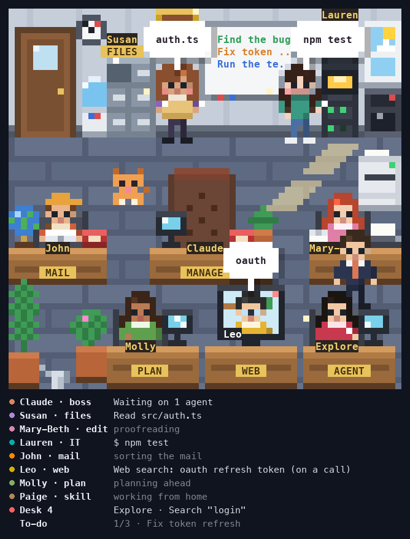

# claude-code-mods

Small mods (plugins) that change how Claude Code looks and sounds.

| Mod | What it does |
|---|---|
| [producer-tag](producer-tag/README.md) | An anime voice says 「マスター！確認してください」 ("Master! Please check this.") when Claude needs your input, or finishes work that took 10 seconds or more. |
| [usage-forecast](usage-forecast/README.md) | A "weather report" above the prompt: how full the context is, plus your session and weekly limits. |
| [pixel-office](pixel-office/README.md) | A pixel-art office beside your chat. You are the CEO, Claude is the Manager, and every tool call sends a staff member to do the job. |

## pixel-office at a glance



- **Each tool call is a person at work.** Susan reads files, Lauren runs commands, Mary-Beth types, John carries the
  mail and the `git` pushes, Molly keeps the to-dos, Leo and Paige call in from home, agents get a desk of their own.
- **Words in a bubble mean work.** The Manager (Claude) tells you when it needs you: `Your OK?`, `Question?`, `Done!`.
- **It has a day of its own**: breaks between turns, a party after a long turn, lights off after 10 idle minutes,
  holidays through the year, and an office cat.

More in its [README](pixel-office/README.md), or [see it move](https://claude.ai/artifact/SUiAMU8xrVDQ2fgi16TMQd).

## Requirements

| | producer-tag | usage-forecast | pixel-office |
|---|---|---|---|
| **Claude Code** | In a terminal. Tested on 2.1.296; older versions may not load these mods. | same | In a terminal. Tested on 2.1.322. |
| **Computer** | macOS, because it plays sound with `afplay`. Silent on Linux and Windows. | any | any |
| **Login** | any | Signed in with a Claude subscription (not an API key) for the Session and Week bars. With an API key, only the context line shows. | any |
| **Other** | Sound turned on | none | A terminal with 24-bit color. A pane of 64 columns × 33 rows shows the whole office; a smaller one shows a camera view or the list. |

- Check your version with `claude --version`, and update with `claude update`.
- These mods don't run on claude.ai in the browser or in cloud sessions, because those don't load plugins installed on your computer.

## Install

Run in your terminal, one line per mod you want (needs Claude Code 2.1.292 or newer):

```sh
claude plugin install producer-tag --marketplace thangdo19/claude-code-mods
claude plugin install usage-forecast --marketplace thangdo19/claude-code-mods
claude plugin install pixel-office --marketplace thangdo19/claude-code-mods
```

Already inside Claude Code? Type the same line with `/plugin` instead of `claude plugin` (needs 2.1.275 or newer).

<details>
<summary>Older Claude Code (before 2.1.292)</summary>

```sh
claude plugin marketplace add thangdo19/claude-code-mods
claude plugin install usage-forecast@claude-code-mods
```

</details>

## Manage

```sh
claude plugin marketplace update claude-code-mods   # get the newest version
claude plugin disable usage-forecast                # turn a mod off
claude plugin enable usage-forecast                 # turn it back on
```

Or type `/plugin` inside Claude Code to browse and manage them.

## Develop

Run a mod from your own copy instead of the installed one:

```sh
git clone https://github.com/thangdo19/claude-code-mods
claude --plugin-dir <YOUR-PATH>/claude-code-mods/usage-forecast
```

> [!IMPORTANT]
> Replace `<YOUR-PATH>` with the folder where you ran `git clone`, e.g. `/Users/you/projects`.
> Not sure? Run `pwd` in that same folder.

Then, inside a mod's folder:

```sh
claude plugin validate .   # checks the plugin files
claude plugin test .       # runs the tests
```
