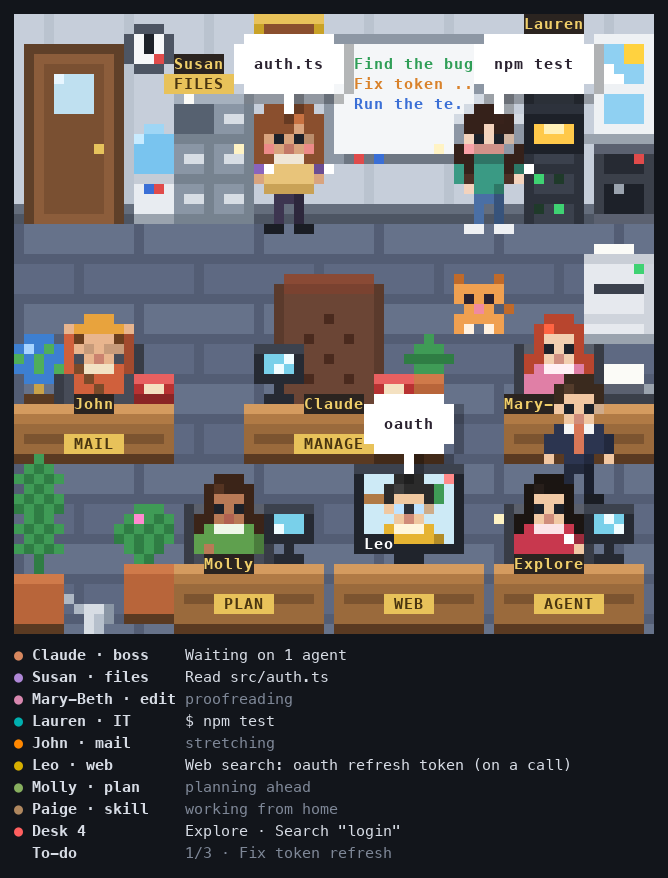

# pixel-office

A tiny pixel-art office in a pane next to your chat. **You are the CEO, Claude is the Manager**, and every tool call
sends a staff member to their spot to do the job.



See it move: [the live intro page](https://claude.ai/artifact/SUiAMU8xrVDQ2fgi16TMQd), drawn by the mod's own code.

## Who does what

| Person | Does | Where |
|---|---|---|
| **Claude**, the Manager | Thinks, plans, asks you questions, hands out the work | The big desk in the middle |
| **Susan**, the Archivist | `Read`, `Grep`, `Glob`, and shell commands that only look (`ls`, `cat`, `grep`) | The cabinets (FILES) |
| **Lauren**, the IT girl | `Bash`, background commands | The server rack (BASH) |
| **John**, the Courier | `git` and `gh`, messages, MCP tools, anything unknown | His desk (MAIL) |
| **Mary-Beth**, the Typist | `Edit`, `Write`, and Claude's reply | Her desk (EDIT) |
| **Molly**, the Planner | To-dos, tasks, schedules, briefing a new agent | A front desk (PLAN) |
| **Leo**, the Researcher | `WebSearch`, `WebFetch` | At home, on the video call (WEB) |
| **Paige**, the Librarian | `Skill`, `ToolSearch` | At home, on the video call (SKILL) |
| Agents | Their own work | A front desk (AGENT); more than two wait in line at the door |
| The Janitor | Sweeps while Claude compacts the conversation | Every hallway |

## How to read it

- **Words in a bubble mean work.** `auth.ts` over Susan: she is reading that file. A red bubble: it failed.
- **A picture bubble or none means a break** (… ha ♥ ♪).
- **The Manager needs you**: `Your OK?`, `Question?`, `Done!`, `On hold`. The Manager picks up the red phone.
- **The board** shows the to-do list. The Manager walks over and ticks each finished line.
- **The list under the picture** names everyone and what they do, in plain words. It is always complete, even when
  the picture is too small to show everyone.

## A day at the office

- **A new session**: the office opens. Everyone walks in, waves, and the two at home say hi on the TV.
- **While Claude works**: everyone is at their desk. A finished job is reported to the Manager.
- **Between turns**: coffee, chats, watering the plants, a paper plane, lunch at noon.
- **A long turn done** (2 minutes or more): confetti and a cake.
- **After 10 idle minutes**: everyone goes home, the Manager last, and the lights go off. Type, and they come back.
- **The window** follows your clock: morning, day, sunset, night.
- **Holidays** dress the office: every US holiday plus Tết. Christmas builds up from November 1.
- **The office cat** naps on the windowsill and strolls the halls.

## Open and close

The pane opens by itself when a session starts. Close it and it stays closed. Type `/office` to open it again.

## Fits any pane

| Pane | You get |
|---|---|
| 64 columns × 33 rows or more | The whole office, the list under it |
| Smaller | A camera that glides to where things happen, plus the list |
| Too small for a picture | The list alone |

## Requirements

- Claude Code in a terminal. Tested on 2.1.322.
- A terminal with 24-bit color. The picture is made of half-block characters (`▀`), so any monospace font works.

## Install

```sh
claude plugin install pixel-office --marketplace thangdo19/claude-code-mods
```

More ways (inside Claude Code, older versions): see the [main README](../README.md#install).

## Develop

```sh
claude --plugin-dir <YOUR-PATH>/claude-code-mods/pixel-office
```

Inside `pixel-office/`:

```sh
claude plugin validate .                          # checks the plugin files
claude plugin test .                              # runs the tests, golden frames included
npx -y -p typescript@5.6.3 tsc --noEmit -p .      # type check
```

`tools/` has node-only scripts (how to run each is at the top of the file): `fuzz.ts` checks the office's rules over
seeded days, `bench.ts` measures speed, `golden.ts` remakes the golden frames after a change you can see, `shots.py`
takes screenshots of a real session.
