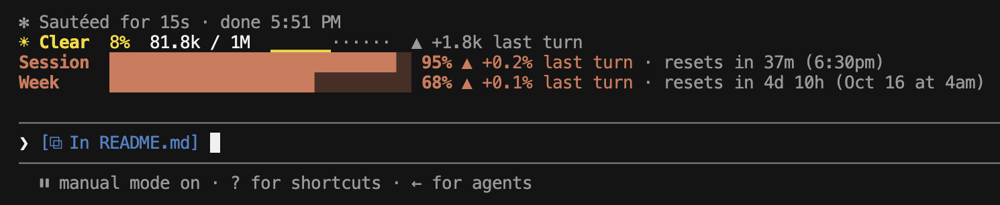

# usage-forecast

A live "weather report" above the prompt: how full Claude's memory is, and how much of your usage limits you've used.



## How to read it

**Line 1: the context window** (how much of Claude's memory this conversation fills)

| Part | Meaning |
|---|---|
| `◆ Opus 5.5 high` | The model answering you, and its effort (how hard it thinks). Effort shows after Claude's first reply. |
| `☀ Clear` | The weather for how full it is (see below). |
| `8%`  `81.8k / 1M` | Tokens used out of the total. A token is a small piece of text, about ¾ of a word. |
| `▁▁▂▂▃▆······` | A chart of the last 12 turns. Dots are turns not taken yet. |
| `▲ +1.8k last turn` | What your last turn added. `▼ −N compacted` means a compaction shrank it. |

| Weather | Full |
|---|---|
| ☀ Clear | under 25% |
| ☁ Cloudy | under 50% |
| ☂ Showers | under 75% |
| ☇ Storm | under 90% |
| ↯ Compact soon | 90% and up |

**Lines 2–3: your usage limits** (the same bars as `/usage`)

| Part | Meaning |
|---|---|
| `Session` / `Week` | Your 5-hour limit and your weekly limit. |
| `95%` | How much of that limit you've used. The bar turns red at 90% and up. |
| `▲ +0.2% last turn` | What your last turn used. |
| `+0.1% this turn` | What the running turn has used so far (only while Claude works). |
| `resets in 37m (6:30pm)` | Time left until the limit resets, then the clock time. |

## Install

```sh
claude plugin install usage-forecast --marketplace thangdo19/claude-code-mods
```

More ways (inside Claude Code, older versions): see the [main README](../README.md#install).

## Develop

```sh
claude plugin validate .
claude plugin test .
npx -p typescript tsc -p .   # type check
```

- `hooks/weather.ts`: formatting helpers (no Claude Code calls, easy to test).
- `hooks/register.tsx`: the hooks and the band above the prompt.
- `types/index.d.ts`: the shape of the saved state.

## Limits

- The limit bars need a Claude subscription login. With an API key they stay hidden.
- Limits come in whole points, so a small turn often reads `<1%`.
- It only counts Claude Code on this computer. Using claude.ai or another computer at the same time makes the per-turn figures read a little high.

## Details

- **Updates:** after every reply from Claude, even mid-turn. The countdown ticks once a minute while idle. The chart and "last turn" figures move once per finished turn of yours. Helper agents (subagents) and turns cancelled before any reply don't count.
- **Several sessions at once:** the % figures show *this session's* share, not the whole account's. The mod learns how many % each $1 of usage costs, then multiplies by what this session spent. Until it has learned that (each limit needs $1 spent and 2 points moved), it shows the account's change instead.
- **Messages you may see:**
  - `waiting for first reply`: a new session, before Claude has answered.
  - `measuring…`: right after a compaction, `/clear` or `/resume`, until the next reply.
  - `↺ reset this turn` / `↺ reset last turn`: the limit reset during that turn.
  - `window reset`: the limit's reset time has passed, until a new reading arrives.
  - `↻ switched from Opus 5.5`: the model changed (`/model`, or an automatic fallback). Stays until one whole turn has run on the new model. Helper agents' models never count.
- **New session:** the bars show the last readings saved by an earlier session until Claude replies.
- **`/logout`**, or switching to an API key, hides the bars and deletes the saved readings.
